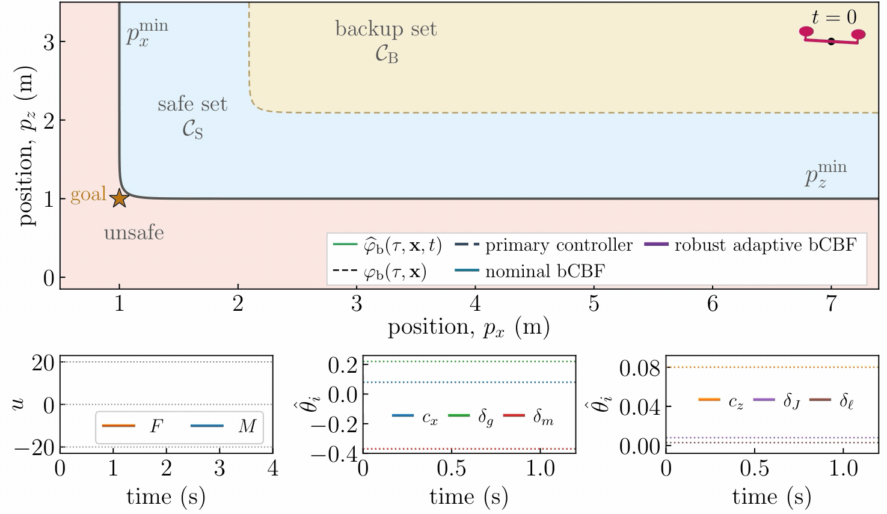

# Robust Adaptive Backup Control Barrier Functions

This repository contains the implementation of **Robust Adaptive Backup Control Barrier Functions**, accepted for publication in IEEE Control Systems Letters (L-CSS), 2026.

Ersin Daş, David E. J. van Wijk, Tamas G. Molnar, Aaron D. Ames, and Joel W. Burdick

[Paper](https://arxiv.org/pdf/2607.20842) · [Figure](media/figure.pdf) · [Video](media/simulation.mp4)

[](media/simulation.mp4)

## Reproducing the results

The `quadrotor` folder contains the planar quadrotor example from the paper: the true and estimated dynamics, the DREM parameter estimator, the nominal and robust adaptive bCBF-QP safety filters.

To install the packages and run the simulations:

```bash
python -m pip install -r requirements.txt
python quadrotor/collect_data.py
```

Saved simulation data are included in `quadrotor/data`. The final paper figure and animation are available in `media`; rerunning the simulations updates the data only.

To run one controller, use `main_sim.py` with `--mode adaptive`, `--mode vanilla` for the nominal bCBF, or `--mode nominal` for the primary controller alone:

```bash
python quadrotor/main_sim.py --mode adaptive
```

The simulation uses a 1 s backup horizon and a 10 ms sampling period. 

## Supplementary material

[Supplementary Material.pdf](Supplementary%20Material.pdf) gives the proof that the backup controller renders the backup set forward invariant (Proposition 1). 
